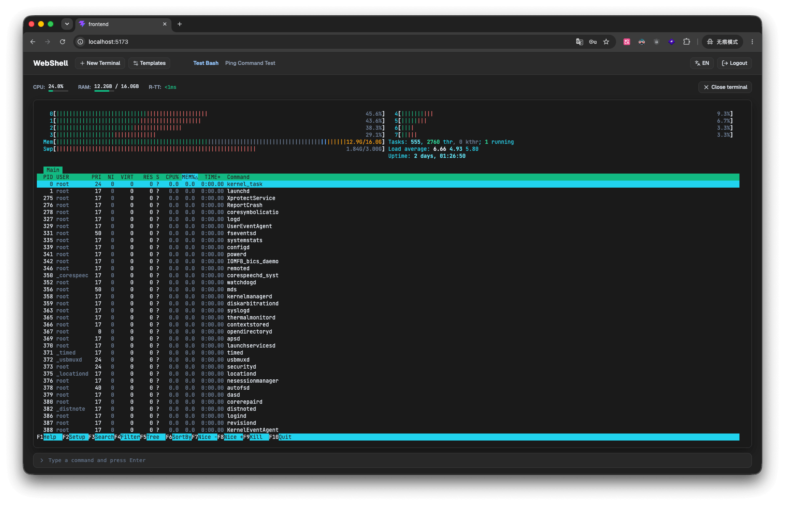

# Pocket Term

简体中文 | [English](README.md)

[](https://go.dev/)
[](https://nodejs.org/en/download/)
[](https://github.com/MCSManager)

一个用 Go 实现的极其简单的服务器管理程序，在浏览器中同时管理多个 Shell 窗口，每个 Shell 都是一个**真实的本地 SSH 服务**，可以让你手机、电脑和平板轻松的快速访问你的服务器。



## 架构

```
Browser ──HTTP/JSON──> Gin ──> handler ──> service ──> model.Store (JSON file)
   │                    │
   │                    └─(start terminal)──> pty.Manager.Start(template)
   │                                          │ SSH client (golang.org/x/crypto/ssh)
   │                                          ▼
   │                                  Local SSH server (gliderlabs/ssh, 127.0.0.1)
   │                                          │ PTY + shell ($SHELL / bash)
   │
   └──WebSocket──> Gin (upgrade) ──> ws.Conn ──> pty.Session (stdin/stdout bidirectional bridge)
```

## 快速开始

```bash
# 构建 binary
cd backend
go build -o bin/webshell ./cmd/webshell

# 运行(首次运行自动生成 config.json 和 data/)
./bin/webshell
# → webshell listening on 0.0.0.0:8080 (ssl=false), ssh backend on 127.0.0.1:2222

# 访问面板
curl -s http://127.0.0.1:8080
```

## 技术栈

- Go 1.24+(用 1.25 toolchain 自动解析构建)
- [Gin](https://github.com/gin-gonic/gin) HTTP 框架
- [gorilla/websocket](https://github.com/gorilla/websocket) WebSocket
- [gliderlabs/ssh](https://github.com/gliderlabs/ssh) 本地 SSH server
- [golang.org/x/crypto/ssh](https://pkg.go.dev/golang.org/x/crypto/ssh) SSH client
- [golang-jwt/jwt/v5](https://github.com/golang-jwt/jwt/v5) JWT
- [creack/pty](https://github.com/creack/pty) server 端 PTY 分配
- bcrypt 密码哈希;`google/uuid` 生成 ID
- 测试:Go `testing` + Node.js(`ws` + 内置 `fetch`)

## 配置(`config.json`,运行目录下自动生成)

```json
{
  "server": {
    "host": "0.0.0.0",
    "port": 8080,
    "ssl": { "enabled": false, "cert_file": "", "key_file": "" }
  },
  "ssh": {
    "listen": "127.0.0.1:2222",
    "passcode": "<auto>",
    "host_signer_file": ""
  },
  "jwt": { "secret": "<auto>", "ttl_minutes": 1440 },
  "storage": { "dir": "./data" },
  "cors": { "allowed_origins": ["*"] }
}
```

### SSO 快速登录

1. Admin 调用 `POST /api/v1/sso/tokens {username}` 生成一次性 token → 返回 `{uuid, password, username}`(仅返回一次)。
2. 外部系统使用 `POST /api/v1/sso_login?uuid=<uuid>&password=<pwd>`(或 `?redirect=1`)直接进入已登录状态。
3. token 为一次性,使用后即失效;重复使用返回 `1003`。

## 测试

### Go 单元 / 集成测试

```bash
cd backend
go test ./...                 # 全部 package
go test -race ./...           # 带 race 检测(PTY / store 并发)
```

覆盖范围:config 加载、auth(JWT + bcrypt)、model 并发 store、本地 SSH server(含自然退出无泄漏回归)、PTY manager 广播、WS frame 解析 + 桥接、service 业务、handler + middleware、router。

### Node.js 端到端测试

```bash
cd tests
npm install                   # 安装 ws
npm test                      # 等价于 node --test
```

全链路:`check-setup → setup → login → me → template CRUD → 启动 terminal → WebSocket 执行 ping 收到 PING → 交互式 echo → resize / close 控制帧 → session 状态变为 closed → destroy → SSO mint / login / reuse-rejected / 302 redirect`。`ws-frames.test.js` 通过真实 backend 验证 control-frame / data-frame 解析契约。

> **macOS sandbox / CI 注意**:`npm test` 会 spawn backend binary。在受限环境(sandbox、部分 CI)下,macOS TCC 可能因 `com.apple.provenance` xattr 而 SIGKILL 子进程。`helpers.js` 会尽力清除 xattr 并做 ad-hoc 签名;若仍失败,请在正常交互式终端运行,或先 `cd backend && go build -o bin/webshell ./cmd/webshell` 再 `npm test`。也可通过 `WEBSHELL_TEST_BIN=/path/to/webshell npm test` 指定 binary。

## 许可证

此项目遵循 [MIT License](LICENSE) 协议，Copyright 2026 [yumao233](https://github.com/yumao233).
